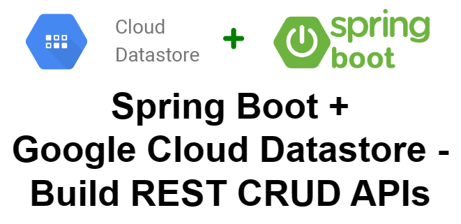
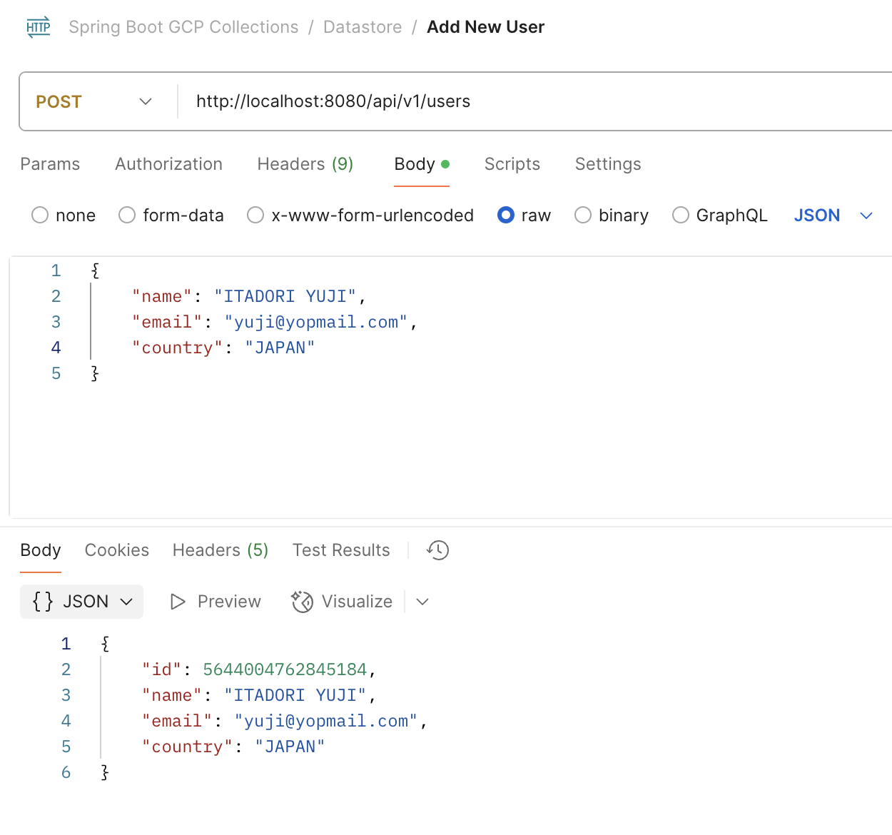
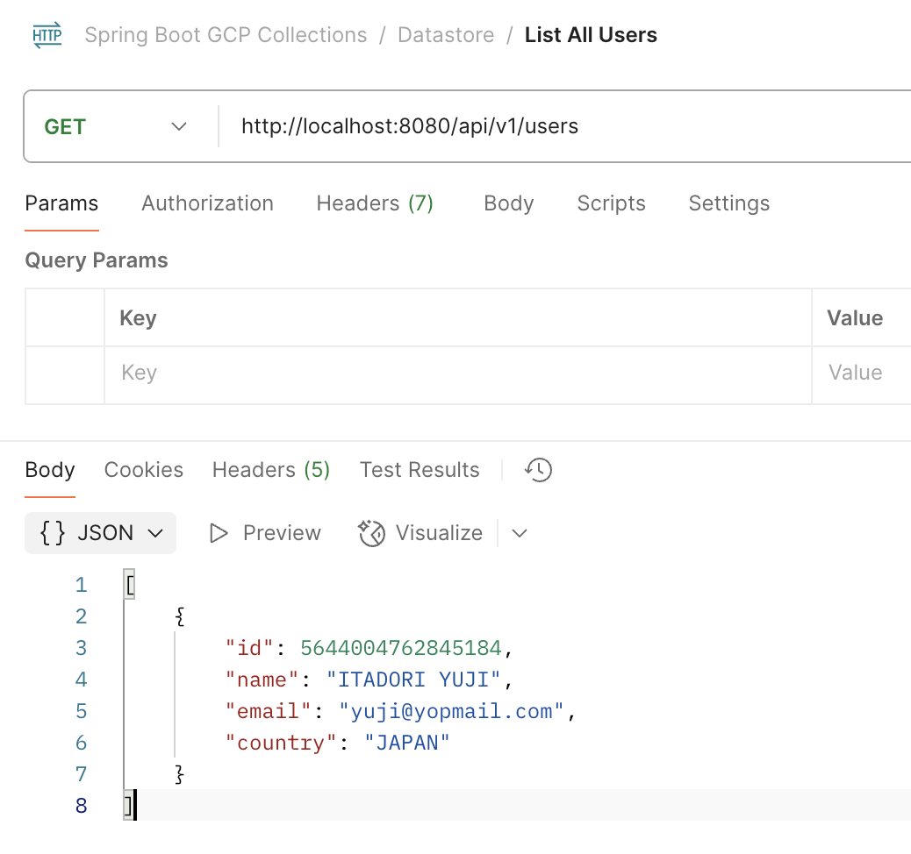
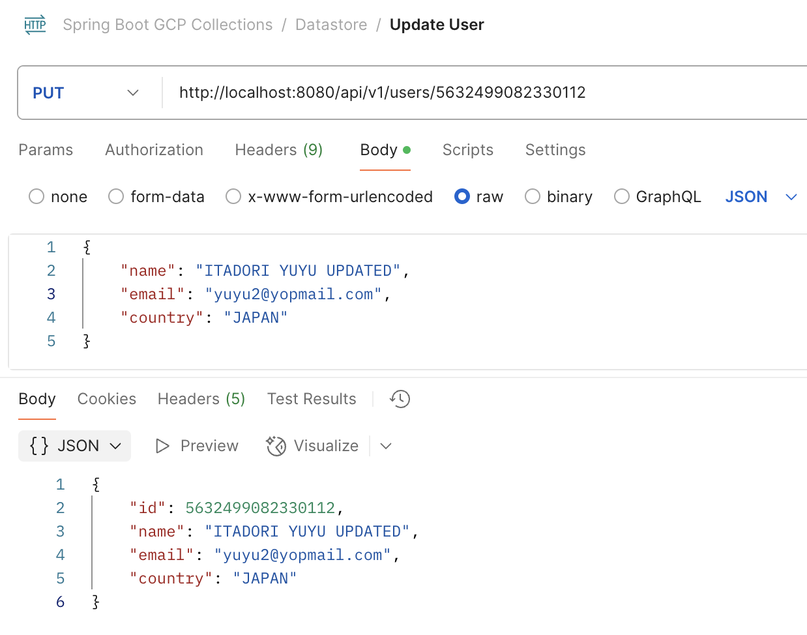
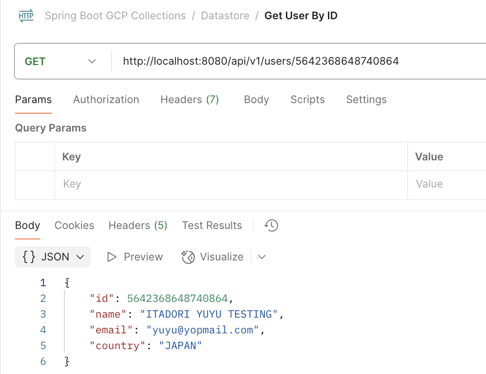
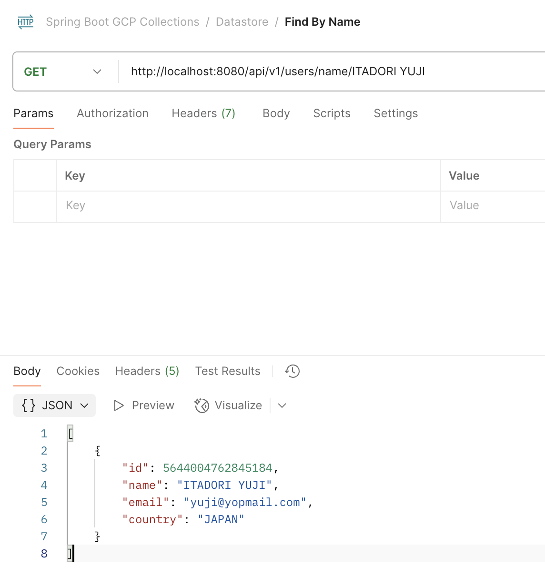
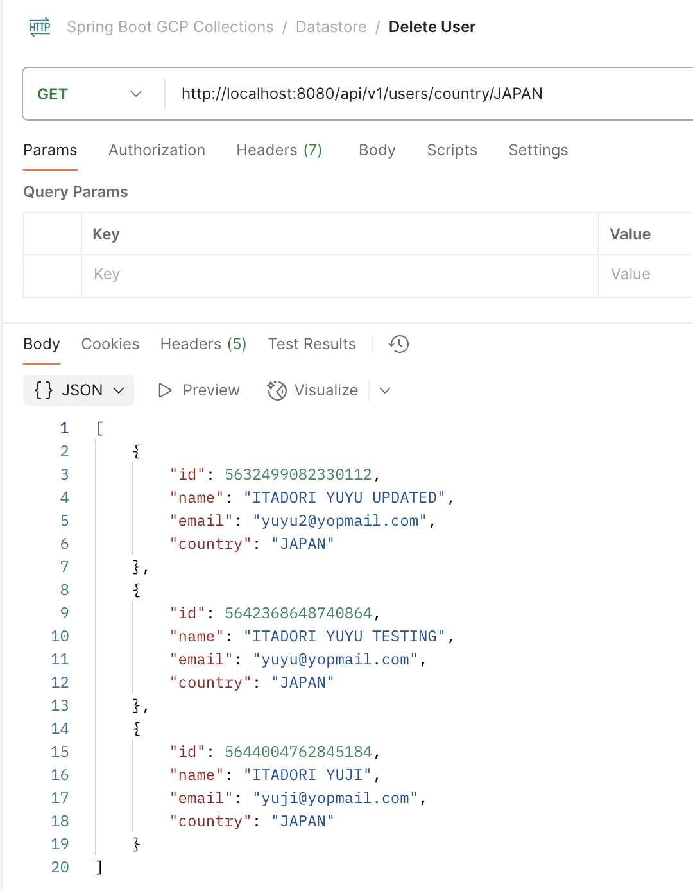
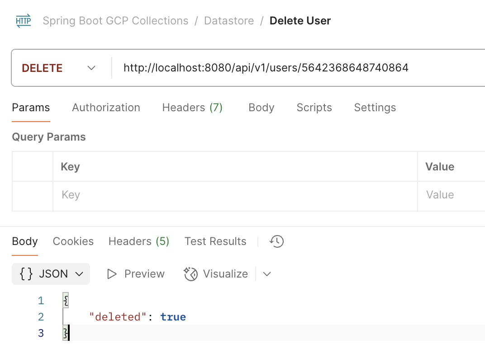

# spring-boot-gcp-datastore

[](https://github.com/hendisantika/spring-boot-gcp-datastore/actions/workflows/maven.yml)



A sample Spring Boot application that stores data in Google Cloud Datastore. It exposes a REST API for `User` entities and
an interactive Spring Shell for `Book` entities.

### Tech Stack

- Java 25
- Spring Boot 4.1
- Spring Cloud GCP 8.2 (Datastore starter)
- Spring Shell 4
- Lombok
- Maven

### Things to do list:

1. Clone this repository: `git clone https://github.com/hendisantika/spring-boot-gcp-datastore.git`
2. Go to the folder: `cd spring-boot-gcp-datastore`
3. Make sure JDK 25 is installed: `java -version`
4. Set up your GCP project and enable the Datastore API
5. Create a service account, download its JSON key, and put it in `src/main/resources`
6. Update `src/main/resources/application.properties` with your project ID and key file name:
   ```properties
   spring.cloud.gcp.datastore.project-id=<your-project-id>
   spring.cloud.gcp.credentials.location=classpath:<your-key-file>.json
   spring.cloud.gcp.datastore.credentials.location=classpath:<your-key-file>.json
   spring.cloud.gcp.datastore.namespace=<your-namespace>
   ```
   > Never commit your service account key. `src/main/resources/*.json` is listed in `.gitignore`.
7. Run the application: `./mvnw clean spring-boot:run`
8. Open your favorite browser: http://localhost:8080/api/v1/users
9. Import the Postman collection `Spring Boot GCP Collections.postman_collection.json` and send requests to save data to
   Datastore

### REST API

| Method | Endpoint                          | Description           |
|--------|-----------------------------------|-----------------------|
| GET    | `/api/v1/users`                   | List all users        |
| GET    | `/api/v1/users/{id}`              | Find a user by ID     |
| GET    | `/api/v1/users/name/{name}`       | Find users by name    |
| GET    | `/api/v1/users/country/{country}` | Find users by country |
| POST   | `/api/v1/users`                   | Create a user         |
| PUT    | `/api/v1/users/{id}`              | Update a user         |
| DELETE | `/api/v1/users/{id}`              | Delete a user         |

### Shell Commands

When the app starts, it opens a Spring Shell prompt with these commands for `Book` entities:

| Command                                  | Description                         |
|------------------------------------------|-------------------------------------|
| `save-book <title> <author> <year>`      | Save a book to Cloud Datastore      |
| `find-all-books`                         | Load all books                      |
| `find-by-author <author>`                | Load books by author                |
| `find-by-year-after <year>`              | Load books published after a year   |
| `find-by-author-year <author> <year>`    | Load books by author and year       |
| `remove-all-books`                       | Remove all books                    |

### Build & Test

```shell
./mvnw clean package
```

The context test runs without real GCP credentials, so it also works in CI.

### CI & Dependency Updates

- **GitHub Actions** (`.github/workflows/maven.yml`) builds and tests the project with Temurin JDK 25 on every push and
  pull request to `main`, and can also be run manually.
- **Dependabot** (`.github/dependabot.yml`) checks Maven and GitHub Actions dependencies every day at 05:00 (Asia/Jakarta).
  It groups related updates (Spring Boot, Spring Cloud, Spring Cloud GCP, Spring Shell, Maven plugins, and other
  minor/patch bumps) and uses the conventional commit prefixes `build(deps)` and `ci(deps)`.

### Image Screen shot

Add User



List User



Update User



Find User By Id



Find User By Name



Find User By Country



Delete User


